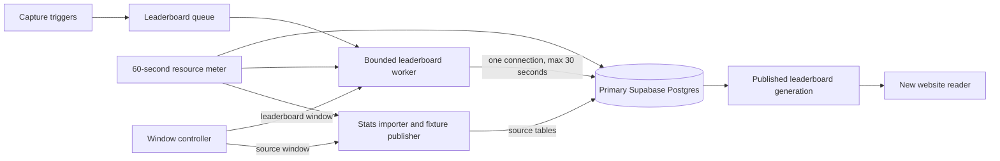

# Leaderboard dedicated resource lane plan

Status: **review draft — user-performed Small compute resize complete; no leaderboard workload is authorised by this document**

Plan date: **26 November 2026**

Production Supabase project: **`cxgnnelmgoagopngjosv`**

## 1. Decision in plain English

The new leaderboard can continue using the existing Supabase database, but it must not be allowed to run as fast as possible without measuring the shared hardware.

The recommended route is:

1. upgrade the database from its original Micro-sized profile to **Small**;
2. give the leaderboard its own scheduled operating windows;
3. allow only one leaderboard database connection and one bounded batch at a time;
4. measure CPU, memory, disk I/O, connections, WAL, temporary files and table growth before and after every batch;
5. ramp from one batch to normal throughput only after measured green results;
6. stop automatically if the source publisher, importer or database deteriorates;
7. drain the backlog, certify the new reader and switch Production;
8. observe the new reader for seven days while it is active.

> **Simple explanation:** We are giving leaderboards an appointment rather than letting it join a traffic jam. The database is still one shared bridge, so a meter checks the bridge before and after every vehicle crosses.

This replaces the current indefinite wait for a 40-sample importer p95 to turn green. That p95 remains a warning and a post-window outcome check; it is no longer the sole permission switch for a leaderboard batch that runs in a separate, quiet window.

## 2. What was checked

The following values were read from Production between 20:15 and 20:18 UTC on 26 November 2026. The checks were read-only.

| Area | Observed evidence | Interpretation |
|---|---:|---|
| Supabase project | `ACTIVE_HEALTHY`; zero health advisories | The platform is not reporting a current health fault. |
| Database profile | 2 CPUs, about 0.95 GB RAM, 60 max connections | This matches Supabase's Micro profile. |
| Database size | 51,675,851,923 bytes, about 48.1 GiB | It is far above Supabase's 10 GB Micro recommendation and slightly above the 50 GB Small recommendation. |
| Memory available | 184–288 MB, about 19–30% | This is the main capacity concern. |
| Swap used | about 38–47% | The host has already moved some memory pages to swap. This is not an outage, but it is not a good base for an unrestricted drain. |
| CPU | about 11–12% non-I/O CPU over two one-minute samples | CPU was not saturated during the sample. |
| I/O wait | about 11% in the detailed sample | The database spent a meaningful share of time waiting for storage. |
| Disk device busy | 17–19% per device in the detailed interval; an earlier interval totalled 108% across both devices | Storage was active and variable, but not continuously saturated in the sample. |
| Connections | 36 / 60 total; 3 active; 0 idle-in-transaction; 0 lock waiters | There is current headroom, but Micro has a small ceiling. |
| Free database disk | 89,501,945,856 bytes, about 83.4 GiB | Strong storage-capacity headroom. |
| Leaderboard schema | 1,683,464,192 bytes, about 1.57 GiB | 52% of the existing 3 GiB application cap. |
| Rolling leaderboard WAL | 295,739,344 bytes | About 5.5% of the existing 5 GiB limit. |
| Rolling leaderboard temp | 0 bytes | The current rolling temp budget is clean. |
| Last 16 worker runs | 461 successes, 0 failures | The worker is functioning correctly when admitted. |
| Last 16 run duration | 25.7 s average; 28.4 s maximum | The existing 30-second bound is effective. |
| Last 16 run WAL | 28,852,662 bytes total; 6,789,020 bytes maximum per run | Recent batches are cheap relative to the 5 GiB rolling allowance. |
| Last 16 run temp | 0 bytes | No recent batch spilled to temporary files. |
| Last 24-hour severe resource logs | 0 OOM, disk-full, deadlock, fatal/panic or too-many-connections events | There is no evidence of a current database resource incident. |
| Backlog snapshot | 968 capture rows, 4,565 incomplete generation jobs, 432 pending publications | Work remains. These counts overlap and are not a direct runtime forecast. |
| Current pause | importer processing p95 141,239 ms versus a 138,239 ms ceiling | The existing conservative rolling guard is still red by about 2.2%. |

The recent Postgres statement timeouts were generated by the restricted Operations reader used for bounded monitoring. They are not evidence that the customer-facing database ran out of capacity.

### 2.1 Supabase sizing evidence

Supabase's current sizing guide describes:

- Micro: 2 shared CPU cores, 1 GB memory, 60 database connections, recommended database size 10 GB;
- Small: 2 shared CPU cores, 2 GB memory, 90 connections, recommended database size 50 GB;
- Medium: 2 shared CPU cores, 4 GB memory, 120 connections, recommended database size 100 GB.

Official reference: [Supabase Compute and Disk](https://supabase.com/docs/guides/platform/compute-and-disk).

Small is slightly below the guide's recommended database-size envelope because the database is about 51.7 GB. That recommendation is not a hard storage limit. Given the measured low CPU use, healthy disk headroom and Jack's cost ceiling, **Small is the right launch compromise**: it doubles memory and raises the connection ceiling while the dedicated lane limits workload concurrency.

Supabase says a compute change usually takes less than two minutes of downtime, although it can take longer. Because the product has not launched, this is the best time to make the change.

The current official guide lists Small at approximately **$15/month**, compared with approximately **$10/month** for Micro. Billing is hourly and the dashboard shows the final price.

> **Simple explanation:** The database was running on roughly 1 GB of memory even though it stores about 52 GB of data. Small doubles that memory. It is not unlimited capacity, so the metered lane remains essential.

### 2.2 Completed resize evidence

Jack initiated the Micro-to-Small resize through Supabase. Read-only verification at 20:33 UTC on 26 November found:

- project `ACTIVE_HEALTHY`;
- unchanged project, database host and Postgres 17 identity;
- 90 maximum connections, matching Small;
- 512 MB shared buffers, up from 256 MB;
- 1,924,177,920 bytes total host memory, about 1.79 GiB usable;
- 700,493,824 bytes available memory, about 36%;
- swap use about 28%, improved from the pre-resize 38–47% sample;
- 37 total connections, 3 active, zero lock waiters and zero idle-in-transaction sessions;
- zero open leaderboard worker runs;
- no OOM, disk-full, deadlock or connection-exhaustion signal.

The 29 fatal log entries at 20:29 UTC were the expected `administrator command` and `database system is shutting down` connection terminations during the platform resize. They are not continuing database faults.

## 3. What “a separate slot” does and does not mean

### It does mean

- the source importer and publisher own their scheduled period;
- the leaderboard never begins while either is active or reserved;
- the leaderboard gets a separate period after source work finishes;
- the leaderboard uses its own process, application name, one-connection pool and advisory lock;
- a source overrun cancels the leaderboard slot instead of making both compete;
- the leaderboard releases its connection between batches and never waits while holding a writer lock.

### It does not mean

- separate CPU hardware;
- separate RAM;
- separate database storage;
- separate WAL;
- a licence to ignore source-pipeline health.

> **Simple explanation:** It is a separate lane painted on the same bridge, not a second bridge.

A genuinely separate bridge would require another compute system. Supabase read replicas can remove read work from the primary, but they are read-only. A future version could read source facts from a replica, calculate rankings in an external worker and write only a compact publication back to the primary. That is a useful Phase 2 architecture, but it is not required to launch and it does not solve current publication writes by itself.

Official reference: [Supabase Read Replicas](https://supabase.com/docs/guides/platform/read-replicas).

## 4. Target architecture

The controller is the traffic light. The resource meter is the bridge weight sensor.

## 5. Policy change

The current guard mixes two different questions:

1. **Is the database unsafe right now?**
2. **Was the importer p95 more than 10% above an old baseline across its last 40 comparable samples?**

Those are not the same question. The plan separates them.

### 5.1 Hard red guards

Any of these prevents a leaderboard batch:

- Supabase project not `ACTIVE_HEALTHY`;
- an importer, source publisher, fixture publisher, reconciliation or certification process is active or reserved;
- an open leaderboard run or resource window exists;
- stale disk or Metrics API evidence;
- CPU, memory, I/O, connection, WAL, temp, shadow-size or disk threshold is red;
- lock waiter, idle-in-transaction session, OOM, disk-full, fatal/panic or too-many-connections signal;
- last normal source publication failed or is stale;
- worker release, manifest, cron, database identity or controller hash drift;
- any new worker failure or fallback resource accounting.

### 5.2 Yellow importer signal

The existing 40-sample normalized p95 remains visible and alerting. While it is above 1.10:

- the worker may run only in the dedicated lane;
- the ramp begins at one batch;
- each window must be followed by a successful matched-workload importer observation;
- a bad post-window importer result stops the ramp;
- no unattended backfill is allowed.

The baseline is not silently reset and the 1.10 value is not rewritten. The change is that an old rolling p95 cannot indefinitely block a resource-metered batch when the source system is idle and current database resources are green.

> **Simple explanation:** We keep the warning light, but it no longer locks the garage door forever. A live weight check decides whether one vehicle may cross.

## 6. Initial operating limits

These are launch limits, not permanent claims about maximum capacity. They must be encoded in a fail-closed controller and covered by offline tests.

| Metric | Green admission | Pause after a batch | Existing hard ceiling |
|---|---:|---:|---:|
| Metrics sample age | no more than 90 s | missing sample | n/a |
| CPU non-I/O usage | below 50% over 5 min | above 70% for 2 samples or above 85% once | n/a |
| I/O wait | below 20% over 5 min | above 30% for 2 samples | n/a |
| Per-device disk busy | below 70% over 5 min | above 80% for 2 samples | platform capacity |
| Memory available after Small upgrade | at least 25% and 384 MiB | below 20% or 256 MiB | n/a |
| Connection use | no more than 75% of `max_connections` | no more than 15% free or any pool wait | 90 on Small |
| Active DB sessions | no more than 10 | more than 15 | n/a |
| Lock waiters / idle in transaction | 0 / 0 | any new occurrence | 0 expected |
| Free database disk | above 40 GiB | below 30 GiB | existing 20 GiB stop |
| Shadow schema size | below 2.4 GiB | at or above 2.4 GiB | existing 3 GiB stop |
| Rolling leaderboard WAL | below 4 GiB | at or above 4 GiB | existing 5 GiB stop |
| Rolling leaderboard temp | below 384 MiB | at or above 384 MiB | existing 512 MiB stop |
| One run WAL | expected below 16 MiB | above 32 MiB | rolling ceiling still applies |
| One run temp | expected 0 | above 0 is yellow; above 32 MiB is red | rolling ceiling still applies |
| Worker failures | 0 | any failure | 0 expected |
| Worker run time | no more than 30 s | timeout or open run after exit | 30 s |

The CPU and disk percentages require two consecutive samples before pausing unless the one-sample hard level is crossed. This avoids stopping on one harmless spike while still reacting quickly to sustained pressure.

The controller must record the raw metric values, not just a green/red verdict.

## 7. Execution plan

### Phase 0 — independent review and freeze

Technical steps:

1. Review this architecture, thresholds and rollback.
2. Freeze the exact Operations worker release, controller source, runtime manifest, environment hashes and crontab.
3. Confirm the latest database and source snapshot has not materially drifted.
4. Confirm no other heavy recovery or certification job is scheduled for the change window.
5. Confirm point-in-time recovery/backups are healthy before a compute change.

Exit: review approved and exact bytes pinned.

> **Simple explanation:** Agree the rules and label every part before touching Production.

### Phase 1 — upgrade Supabase compute to Small

Technical steps:

1. Fence leaderboard starts and stop the source supervisor at a clean boundary.
2. Verify zero open leaderboard runs, zero open generation/resource windows and zero active publisher transactions.
3. Save a private before-snapshot of database identity, publications, queue state, connections, Metrics API values and source health.
4. Upgrade Supabase compute from Micro to Small in the dashboard.
5. Wait for `ACTIVE_HEALTHY` and database connectivity to return.
6. Verify Postgres version and project identity did not change.
7. Confirm expected Small capacity: about 2 GB RAM and 90 max connections.
8. Run read-only publication and source-integrity checks.
9. Resume the source publisher/importer only. Keep leaderboard processing paused.
10. Observe at least one ordinary successful source cycle and collect a 15-minute quiet resource baseline.

Rollback:

- if the upgrade fails, use the platform's failed-upgrade restoration path;
- do not resume leaderboard work;
- source services resume only after database identity and integrity pass.

> **Simple explanation:** Give the database more breathing room, then prove normal Odds Search still works before leaderboards run.

Current status: steps 1–8 are complete from the user-initiated resize and read-only verification. Steps 9–10 remain: observe one normal source cycle and collect a quiet post-resize baseline before any leaderboard canary.

### Phase 2 — implement the dedicated-window controller

The controller must:

1. scrape the Supabase Metrics API once per minute to a private root-owned log;
2. read only the named CPU, memory, swap, disk I/O, connection and WAL metrics;
3. verify fresh normal publisher and importer state;
4. reserve the leaderboard lane without holding a database connection;
5. acquire the existing worker/advisory exclusion only immediately before a run;
6. start one worker with a maximum one-connection pool;
7. preserve the current 250-operation and 30-second upper bounds;
8. close and verify exact resource accounting after the run;
9. release every lock and connection;
10. collect after-metrics and wait for the next matched source observation;
11. write a signed/hashed receipt containing the decision and raw evidence;
12. pause automatically on any hard-red condition.

The source publisher owns the beginning and end of each 15-minute cycle. The leaderboard lane is the middle period only after source completion. The initial proposal is no more than four 30-second batches in one 15-minute cycle, at least 90 seconds apart.

If source work overruns, the leaderboard slot is skipped. Nothing waits while holding the database writer lock.

> **Simple explanation:** Source data gets first use of the database. Leaderboards use the quiet middle, then get out before the next source update.

### Phase 3 — offline and Preview validation

Required tests:

- missing/stale Metrics API sample refuses admission;
- CPU, memory, I/O, connection, WAL, temp, disk and shadow thresholds each refuse admission;
- source reservation or overrun skips cleanly;
- foreign/stale lock refuses admission;
- a worker timeout closes/reconciles its exact run and retains pause;
- a failed batch stops the ramp;
- fallback resource accounting stops the ramp;
- lost acknowledgement does not create a second worker;
- post-window importer deterioration stops subsequent windows;
- a successful run releases every lock and connection;
- controller restart cannot repeat a consumed batch receipt;
- no secret appears in logs or artifacts.

Run these against disposable Postgres and mocked Prometheus fixtures. Do not use Production to discover controller bugs.

> **Simple explanation:** Break the traffic light in a laboratory before trusting it on the road.

### Phase 4 — supervised ramp

#### Step A: one canary batch

- one worker invocation;
- maximum 30 seconds;
- maximum one database connection;
- exact accounting required;
- zero failed items;
- collect two post-run Metrics API samples;
- require the next matched source cycle to succeed.

#### Step B: one complete 15-minute lane

- up to three additional batches;
- at least 90 seconds apart;
- stop immediately on a red threshold;
- verify the next source/publisher cycle before continuing.

#### Step C: two-hour controlled drain

- up to four batches per 15-minute cycle;
- one active batch at a time;
- no backfill;
- review the first hour before allowing the second;
- preserve every batch receipt.

#### Step D: bounded unattended drain

Only after Steps A–C pass:

- keep the same four-batch-per-cycle ceiling;
- retain automatic pause;
- alert after one failure rather than retrying blindly;
- continue until the live queue/publication gap is current.

> **Simple explanation:** One batch, then one window, then two hours, then normal operation. We increase speed only after the database proves it can carry the previous level.

### Phase 5 — drain and publication completion

Completion requires all of the following at one stable boundary:

- capture queue empty or current with no aged dirty work;
- no incomplete generation job for the supported cohort set;
- no pending publication for a changed cohort;
- publication cursors equal committed source cursors;
- zero open runs/windows;
- zero new failed rows;
- resource meter green;
- latest source publisher and normal odds delivery green.

Backfill stays disabled. If a separate gap audit proves missing historical coverage, it gets its own reviewed, bounded plan.

### Phase 6 — certify and switch the reader

1. Build a protected Preview from one pinned website commit with the new reader enabled.
2. Run the existing authenticated customer acceptance suite.
3. Run the independent source/ranking oracle, including an expected top-player comparison.
4. Run the five-request latency test and describe it accurately as five requests through one authenticated session.
5. Require a stable complete publication fingerprint across all tests.
6. Deploy that exact commit to Production.
7. Run the authenticated Production smoke.
8. Start the seven-day observation immediately after the smoke passes.

The legacy reader remains dormant as rollback during the seven days. It does not remain the normal path.

> **Simple explanation:** Once the factory has caught up, test the finished product, turn it on, and watch it while it is actually being used.

## 8. Automatic rollback and stop behaviour

The worker is paused, not destroyed, when a threshold trips.

Immediate response:

1. fence new leaderboard starts;
2. let an active statement finish only within its existing timeout;
3. close or reconcile the exact worker/resource window;
4. verify worker disabled, backfill disabled and zero open runs;
5. leave capture enabled so no source change is lost;
6. keep normal source/publisher work running if healthy;
7. preserve the failure receipt and raw resource evidence;
8. diagnose before any retry.

Reader rollback remains a server-side flag/deployment rollback. Database data is not deleted during an operational rollback.

> **Simple explanation:** Stop the leaderboard car, keep recording new work, and let the rest of Odds Search continue.

## 9. When to build a truly separate compute road

Move ranking calculation off the primary database if any of these happens after the Small upgrade:

- two resource-triggered pauses in one UTC day;
- the backlog cannot decrease across four green operating windows;
- memory remains below 20% available during quiet periods;
- I/O wait remains above 20% or disk busy above 70% during quiet periods;
- source/publisher latency worsens after matched leaderboard windows;
- steady-state leaderboard work consumes more than 25% of the primary's measured CPU or write throughput.

The next architecture would be:

1. read immutable source facts from a read replica;
2. calculate rankings in an external worker or separate Postgres project;
3. send a compact, idempotent publication transaction to the primary;
4. keep the website reader on the primary's published snapshot.

That is the real second road. It costs more and adds replication-lag and deployment complexity, so it should be triggered by measurements rather than built speculatively before launch.

## 10. Estimated timeline after approval

These are working estimates, not guarantees:

| Work | Estimate |
|---|---:|
| Final review and exact-byte freeze | 1–2 hours |
| Small compute upgrade | complete |
| Post-upgrade source smoke and quiet baseline | 15–30 minutes after normal scheduling resumes |
| Controller implementation and offline tests | 4–8 hours |
| Supervised ramp A–C | about 3 hours |
| Backlog drain | likely 4–12 hours at the proposed ceiling; measured progress decides |
| Reader certification and Production switch | 2–4 hours after a clean drain |
| Seven-day pre-launch observation | starts after the switch; it does not delay internal activation |

The fastest credible target is to activate the new reader within roughly one day of an approved plan, provided the post-Small source check, controller tests, ramp and drain all pass. A resource trip extends the timeline because the system should stop rather than damage normal ingestion.

## 11. Approval requested

The reviewer is asked to approve or reject these specific decisions:

- [x] Upgrade Production Supabase compute from Micro to Small before the drain and verify the new capacity.
- [ ] Replace the importer p95 as the sole leaderboard lock with the dedicated-window policy, while preserving it as a warning and post-window outcome check.
- [ ] Use the thresholds in Section 6 as the initial fail-closed limits.
- [ ] Permit no more than four bounded batches per 15-minute leaderboard lane after the supervised ramp passes.
- [ ] Keep backfill disabled during launch drain.
- [ ] Switch the new reader immediately after clean drain and certification.
- [ ] Run the seven-day gate with the new reader active and the legacy reader dormant.
- [ ] Trigger separate compute architecture only from the measured conditions in Section 9.

No approval item authorises hidden threshold changes, counter resets, extra retries, an unbounded worker, or deletion of audit history.

